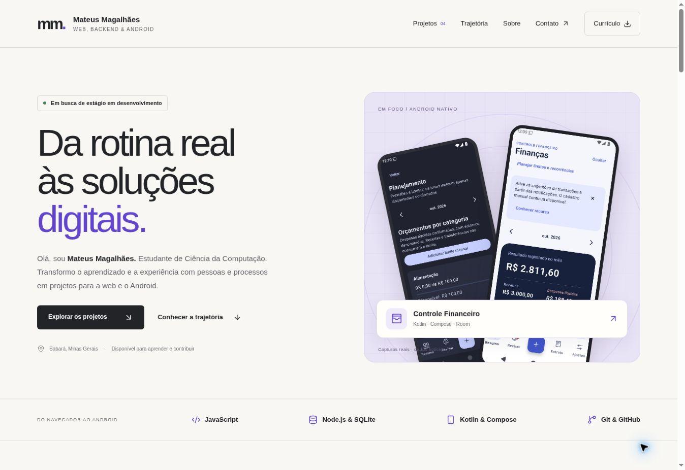
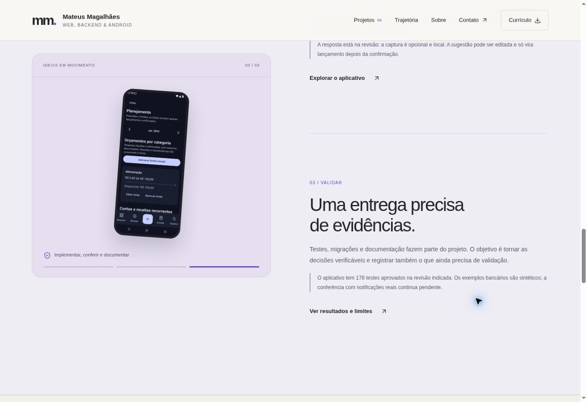
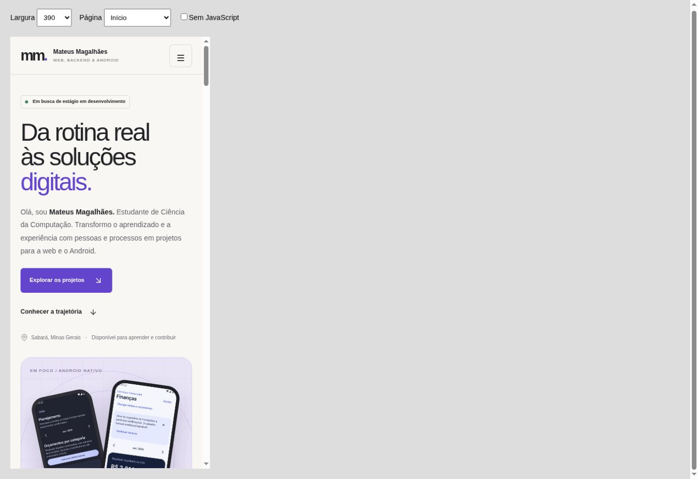

# Qualidade e validação

Registro da primeira versão, conferida em **22 de outubro de 2026**, no fuso `America/Sao_Paulo`.

## Referência e escopo

O repositório de destino continha somente o README inicial. O escopo desta entrega é o portfólio estático e a demonstração Fluxo. O código da Barbearia do Semá pertence a outro repositório e não foi alterado por esta entrega.

## Verificações executadas

| Verificação | Resultado | Evidência |
| --- | --- | --- |
| `npm test` | 24 aprovados, 0 falhas e 0 pulados | `test/solicitacoes.test.mjs` |
| `npm run check` | Aprovado | 5 páginas HTML, 91 referências e 16 arquivos publicados; caminhos, âncoras, descrições de imagens e sintaxe JavaScript |
| Responsividade | Sem rolagem horizontal nas cinco páginas | Chromium, em frames com larguras de viewport de 320, 390, 768 e 1440 px |
| Imagens da página inicial | Carregadas | Captura e inspeção no Chromium |
| Filtros de projetos | Aprovados | Todos: 3; frontend: 2; full stack: 1; ativação por teclado |
| Menu móvel | Aprovado | Abertura por Enter, Escape para fechar e atualização de `aria-expanded` |
| Atalho para conteúdo | Aprovado | Enter em “Pular para o conteúdo” leva o foco a `main`; Tab segue para o primeiro link da apresentação |
| Criação no Fluxo | Aprovada após correção | 6 registros iniciais, criação eleva o total para 7 |
| Status e persistência | Aprovados | Alteração para concluída preservada após navegar/recarregar a demo |
| Busca e combinação de filtros | Aprovadas | Busca sem acento encontra título acentuado; prioridade incompatível apresenta estado vazio |
| Entradas como texto | Aprovadas | Um título com marcação `<b>` é mostrado literalmente, sem criar elemento HTML |
| Restauração da demo | Aprovada | Confirmação restaura os seis exemplos |
| Diálogo por teclado | Aprovado | Escape fecha o diálogo e retorna o foco ao botão de nova solicitação |
| Exportação CSV | Aprovada | Arquivo baixado pelo Chromium e lido como CSV: cabeçalho e seis registros, com seis colunas |
| Currículo público | Aprovado como arquivo | Uma página; texto extraído e renderização inspecionada; links embutidos; sem telefone, endereço completo ou CEP |
| Cópia de e-mail bloqueada | Alternativa aprovada | Retorno textual após indisponibilidade da área de transferência; link de e-mail permanece disponível |

Os frames usam o motor real do Chromium. A barra de rolagem pode reduzir a largura útil do documento em 15 px. Essa conferência de layout não representa execução em aparelhos físicos.

## Correções durante a conferência

- A criação da solicitação dependia de `crypto.randomUUID`, indisponível no contexto HTTP do preview. O identificador passou a usar `crypto.getRandomValues`, sem depender de contexto seguro para esse recurso. A criação e a persistência foram novamente exercitadas.
- Os marcos principais receberam `tabindex="-1"` para tornar verificável o foco do atalho que pula a navegação.
- A tentativa de copiar e-mail passou a informar o andamento e oferecer retorno textual se a permissão não for resolvida. O botão é liberado novamente após a tentativa.

## Cobertura dos testes do modelo

São exercitados os exemplos iniciais, a leitura de dados salvos, listas vazias, JSON inválido, versões incompatíveis, identificadores duplicados, limites de tamanho, valores inesperados, normalização de datas, busca com acentos, combinação de filtros, ordenação, contagens, atualização de status e CSV.

Os cenários de CSV incluem aspas, vírgulas, quebras de linha, BOM UTF-8 e neutralização de possíveis fórmulas. As funções não alteram o estado original ao selecionar ou atualizar listas.

## Verificações limitadas ou não executadas

- O navegador de teste não confirmou o evento de download do PDF: a espera pela transferência expirou. O arquivo presente no site foi inspecionado e sua referência foi validada; o download do currículo deve ser reconferido no endereço público final.
- A escrita bem-sucedida na área de transferência não foi confirmada neste navegador; o tratamento de indisponibilidade foi exercitado.
- Não houve teste em Android físico, iOS, Safari, Firefox ou leitor de tela. Não foi realizada certificação WCAG, auditoria de segurança externa ou medição Lighthouse.
- Os testes de navegador foram conduzidos nesta sessão de revisão. A integração contínua executa os testes do modelo e a checagem estática, sem prometer uma suíte de navegador automatizada no GitHub Actions.
- A disponibilidade externa de LinkedIn, GitHub e aplicativos de e-mail não é coberta pela checagem local. Links para código devem ser conferidos após o envio ao repositório.
- O job de GitHub Pages é condicionado a `PAGES_ENABLED=true`; ativação, URL pública e permissões de publicação dependem da configuração do repositório e não são resultados dos testes locais.
- A demo não tem autenticação ou backend. Não processa operações empresariais reais. O LocalStorage pode ser removido pelo navegador ou ficar indisponível.
- Os 104 testes da barbearia são evidência da revisão técnica registrada naquele projeto, e não testes desta entrega.

## Repetir a conferência

Execute `npm test` e `npm run check`. Inicie `npm run serve`, abra o endereço local e confira as cinco páginas nas larguras citadas. Use Tab, Shift+Tab, Enter e Escape nos links, no menu e nos diálogos. Na demo, crie um registro fictício, altere seu status, recarregue, filtre, exporte o CSV e restaure os exemplos ao terminar.

Ao atualizar o PDF, confira sua extração de texto, renderização, dados de contato e o download no endereço publicado. Atualize este registro somente para verificações efetivamente repetidas.

## Evolução de apresentação — 24 de outubro de 2026

### Escopo e referência

A referência desta etapa é a main `3e531b92e4501a7f080426a7967a6eb1cb73e7d4`. Antes das alterações, os 24 testes e a checagem das cinco páginas passaram. Os arquivos locais anteriores foram preservados em outro diretório.

A atualização acrescenta o Controle Financeiro Android como quarto projeto, com quatro capturas reais de dados fictícios e estudo de caso próprio. O nome de apresentação passou a Mateus Magalhães; web, backend e Android aparecem nas áreas de interesse. A paleta existente e os endereços profissionais foram conservados.

A narrativa associa observar, construir e validar aos projetos reais. A prévia muda ao longo da rolagem, sem interceptar eventos para bloquear o deslocamento. Os textos não são ocultados ou esmaecidos. Em telas baixas, a imagem deixa de ser fixa; as regras de movimento reduzido mantêm a leitura estática.

### Resultados desta etapa

| Verificação | Resultado | Escopo |
| --- | --- | --- |
| `npm test` | 24 aprovados, sem falhas ou testes pulados | Modelo da demonstração Fluxo |
| `npm run check` | Aprovado | Seis páginas, referências internas, imagens, metadados, âncoras HTML, símbolos SVG e sintaxe JavaScript |
| Responsividade | 24 combinações sem rolagem horizontal | As seis páginas em frames Chromium de 320, 390, 768 e 1440 px; larguras úteis de 305, 375, 753 e 1425 px por causa da barra vertical |
| Imagens | Nenhuma imagem concluída com erro nas 24 combinações | Capturas e ilustrações locais; imagens lazy fora da tela podem permanecer sem carregamento até a rolagem |
| Filtros | Android: 1; frontend: 2; todos: 4 | Resultado textual e visibilidade dos cartões |
| Menu móvel | Aprovado com Enter e Escape | Nome acessível e `aria-expanded` atualizados |
| Atalho de conteúdo | Aprovado | Enter no link leva o foco ao marco `conteudo` |
| Scrollytelling | Três capítulos observados | Estados 01/03, 02/03 e 03/03 com as prévias correspondentes; rolagem e ativação por foco |
| Sem JavaScript | Conteúdo preservado | Quatro projetos, três textos da narrativa, contatos e navegação; filtros permanecem ocultos |
| Vetores | 30 geometrias originais conferidas | Biblioteca Lucide em commit fixado; licença ISC e aviso MIT preservados |
| Dados profissionais | Nome e e-mail conferidos no site | PDF existente e URLs antigas preservados; nome sugerido do download atualizado |
| `git diff --check` | Aprovado | Ausência de erros de espaço na alteração |

Os resultados de layout estão em [responsividade-2026-10-24.json](evidencias/responsividade-2026-10-24.json). A página auxiliar de conferência foi removida antes da publicação. Não foi acrescentada uma dependência de produção ou biblioteca de animação.

### Capturas

### Limites da evidência

As conferências de interface foram realizadas nesta sessão no Chromium e não equivalem a testes em aparelhos físicos. A preferência de movimento reduzido foi revisada no código; não houve troca da configuração do sistema operacional neste navegador. Não foram repetidos testes em leitores de tela, Safari, Firefox ou medição Lighthouse.

A lógica do Fluxo permaneceu igual, e seus 24 testes foram repetidos. O fluxo completo de criação, exportação e restauração da demonstração pertence à evidência da primeira versão acima; não foi repetido integralmente nesta etapa de apresentação. O conteúdo do PDF não foi atualizado, e o evento de download não foi reconferido.

Os 178 testes Android são de uma execução vinculada no estudo de caso e não fazem parte desta suíte. Os casos bancários são sintéticos; o site deixa explícita a ausência de validação real com todos os bancos. As imagens Android são as capturas originais da revisão do aplicativo, sem dados financeiros reais.

A confirmação final de hospedagem depende da execução do workflow de Pages. O CI conserva os testes Node e a checagem estática; as inspeções de navegador desta seção não são apresentadas como uma suíte de CI.

## Manutenção do CSS e testes reproduzíveis de interface

A referência desta etapa é e2beb2dbf5b6d7adeb54c03e5721c8b7c76896bf. Antes das alterações, os 24 testes do modelo e a checagem estática passaram.

O CSS foi formatado e recebeu seções, preservando a ordem das regras. A lógica de rolagem foi extraída para storytelling.js. A validação automatizada de navegador agora cobre a base /Portfolio/, quatro larguras, seis páginas, menu, filtros, foco do atalho de conteúdo, os três capítulos, movimento reduzido, leitura sem scripts e recursos locais.

Os testes de navegador são obrigatórios no CI e a publicação de Pages depende dessa checagem. O resultado efetivo e as capturas ficam na execução vinculada ao pull request. Os 24 testes existentes, o formatador e a checagem estática também permanecem no fluxo.

Esta etapa não altera o currículo, os ícones, os dados da demonstração Fluxo ou a descrição dos projetos. Não houve teste em aparelho físico ou leitor de tela.

A execução [40195153346 do CI](https://github.com/Mateus1804/Portfolio/actions/runs/40195153346) aprovou **24 testes do modelo e dez testes de interface com Chromium**, sem falhas ou testes pulados. Também passaram a formatação e a checagem das seis páginas, 226 referências e 26 arquivos publicados. O artefato `evidencias-interface` registra a captura desta execução por 14 dias; a disponibilidade do artefato é temporária. Os testes de movimento reduzido foram executados com a preferência emulada no navegador.

## Evolução do Fluxo e storytelling — 25/10/2026

### Alterações e critérios de aceite

- Três projetos em destaque e bastidores do portfólio em bloco complementar; ações consistentes e captura principal Android com menor inclinação.
- Quatro etapas da mesma solicitação fictícia no storytelling; sincronização por rolagem no desktop e prévias junto aos textos no celular e com movimento reduzido.
- Edição sem alterar identificador/criação; prazo opcional; filtros de atraso e vencimento no dia; lista e Kanban com o mesmo estado.
- Histórico local limitado a 100 eventos por registro, arquivamento, desarquivamento e desfazer em memória.
- Migração do esquema 1 ao 2; exportação JSON completa; recuperação com validação e prévia; cancelamento e arquivo inválido preservam os dados.
- Conflito entre abas preserva o formulário, pausa a gravação e permite exportar a sessão ou carregar a versão salva com confirmação.
- Mensagens distinguem salvamento local de alterações apenas em memória. A restauração explícita dos exemplos permite recuperar armazenamento corrompido.
- Roteiro guiado, galeria com ampliação por diálogo, vídeo curto do Fluxo com dados fictícios e imagem de compartilhamento própria.

### Comandos executados localmente

| Comando | Resultado |
| --- | --- |
| `npm ci` | Dependências de desenvolvimento instaladas |
| `npx playwright install chromium` | Chromium instalado; um espelho inicial retornou arquivo inválido e o instalador concluiu usando outro espelho oficial |
| `npm run format:check` | Aprovado |
| `npm test` | 38 testes aprovados, sem falhas ou testes pulados |
| `npm run test:browser` | 24 testes aprovados, sem falhas ou testes pulados |
| `npm run check` | 6 páginas, 229 referências e sintaxe JavaScript conferidas |
| `git diff --check` | Aprovado |

A suíte de navegador cobre larguras de 320, 390, 768 e 1440 px sob `/Portfolio/`, filtros, teclado, quatro etapas da narrativa, mudança de movimento reduzido, ausência de JavaScript, migração, edição, prazos, Kanban, histórico, arquivamento, desfazer, download e restauração JSON com cancelamento, rejeição de arquivo inválido, entradas HTML tratadas como texto, conflitos reais entre duas abas e armazenamento bloqueado ou corrompido. Um cenário de texto espaçado em tela de 320 px encontrou transbordamento no cabeçalho e na ordenação; os ajustes passaram na repetição e na suíte completa.

O npm emitiu aviso de configuração ambiental `http-proxy`. Não houve adição de dependências de execução nem atualização geral das ferramentas.

### Inspeção e evidências

A prévia foi inspecionada no Chromium remoto em desktop. Capturas automatizadas complementam a inspeção em desktop e celular, usando exclusivamente dados fictícios:

- [Página inicial](imagens/portfolio-evolucao-desktop.jpg) e [celular](imagens/portfolio-evolucao-mobile.jpg).
- [Storytelling](imagens/portfolio-evolucao-storytelling.jpg).
- [Fluxo desktop](imagens/fluxo-evolucao-desktop.jpg) e [celular](imagens/fluxo-evolucao-mobile.jpg).
- [Kanban](imagens/fluxo-kanban.jpg) e [histórico](imagens/fluxo-historico.jpg).
- Vídeo público em `dist/assets/video/fluxo-demonstracao.webm`, sem autoplay e com legendas descritivas em português. O roteiro de captura é reproduzível; a suíte escreve apenas em `qa/capture/`.

### Limites

Não foram realizados testes com Safari, Firefox, leitores de tela ou aparelhos físicos. A conferência de links internos não comprova disponibilidade externa. As métricas do aplicativo Android continuam vinculadas à revisão original e não foram revalidadas nesta etapa.

Fluxo continua local, com dados fictícios, sem autenticação ou compartilhamento. Histórico não é auditoria empresarial; backup não é criptografado. Limites: 500 registros, 100 eventos recentes por registro e 2 MB serializados. O controle entre abas reduz sobrescritas, mas LocalStorage não garante transações simultâneas. Responsáveis, comentários e sincronização não foram implementados.

Merge e publicação ficam fora desta revisão; os workflows e a configuração de hospedagem foram preservados.
